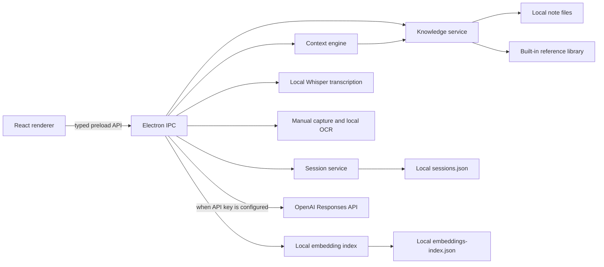

# Architecture

Interview Prep Copilot uses an Electron main process and a React renderer. The renderer has no direct Node.js access. A preload script exposes a small API backed by validated IPC handlers.

The knowledge service searches both imported text/Markdown files and the read-only reference library generated from the supplied full-stack interview site. It groups content by Markdown heading, normalizes phrase variants such as `cherry-pick` and `cherry pick`, and ranks chunks using term coverage, adjacent phrases, headings, and filenames.

The context engine selects the latest question from manual input, transcript, OCR, or history, retrieves note snippets, prepares the answer, and adds confidence and a likely follow-up. API calls stay in focused services.

The session service stores questions, displayed answers, source snippets, transcripts, OCR text, confidence, follow-ups, and creation time as JSON. All writes occur in the Electron main process.

Session export and deletion also run in the main process. Export uses Electron's native save dialog and supports selected or complete history as Markdown or JSON. Markdown includes transcript, captured text, questions, suggestions, weak-area guidance, follow-ups, and practice topics.

The answer service treats local search as a routing decision. A confident built-in reference or personal-note match is returned byte-for-byte from the indexed Markdown section and bypasses generation. Page titles and source-URL metadata are excluded from reference candidates. Only a question with no sufficiently relevant local match can use the isolated `openaiService.ts` boundary when a real API key is present; otherwise the app shows its local missing-context response. The UI labels verbatim local and OpenAI answers separately.

## Security and privacy

- Context isolation is enabled.
- Node integration is disabled in the renderer.
- The preload exposes named operations rather than raw IPC access.
- Only user-selected `.txt` and `.md` files are imported.
- Confident local matches remain local. With a configured key, only questions without a confident local match are eligible for the OpenAI fallback.
- Microphone recording and manual capture require visible user actions.
- Microphone PCM is downsampled to 16 kHz WAV in memory and transcribed by the locally cached Whisper model.
- Speech activity and a short silence boundary define each utterance; a fixed maximum duration prevents an unbounded buffer.
- The renderer lists available audio inputs. PulseAudio monitor inputs are labeled as interviewer/call audio, while a physical microphone is labeled as mixed room audio.
- For mixed room audio, the response guard compares speech with the displayed answer and excludes matching candidate responses from question detection.
- Screenshot OCR is local; temporary screenshot files are deleted after recognition.
- The overlay is clearly labeled and can be hidden from the main window or keyboard shortcut.
- The overlay receives the complete displayed answer and uses the same renderer as the main source card; it does not summarize or truncate source content.
- Semantic indexing is explicit and has a local keyword fallback.

Live OpenAI embeddings and session-review requests remain to be verified after a real API key is supplied. Local Whisper transcription has been verified without an API key. Missing-key paths leave local keyword search and local transcription available.
